# ⚡ ZENTIX - High-Performance Gaming & Hardware Command Center

  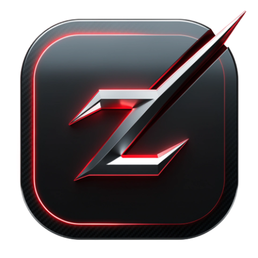

  <b>The ultimate Android gaming assistant combining PC-grade hardware monitoring, console-inspired UI, and advanced optimization tools.</b>

  

---

## 🚀 Overview & Vision
**ZENTIX** is engineered to bridge the gap between heavy PC hardware monitoring software (like MSI Afterburner) and high-end console user experiences (inspired by the legendary PlayStation 3 XMB interface). Designed for mobile gamers and hardware enthusiasts, ZENTIX provides real-time thermal monitoring, FPS tracking, hardware acceleration, and seamless multi-language localization.

---

## 🛠️ The Engineering Journey: Challenges & Solutions

During the development of ZENTIX, several complex architectural and UI/UX challenges were successfully resolved:

1. **Dynamic Multi-Language Integration & Onboarding Sync:**
    * *Challenge:* Initial language selection and app description screens were hardcoded to English and didn't reflect dynamically across the entire app ecosystem when users selected languages like Korean, Chinese, German, or Arabic.
    * *Solution:* Built a unified global configuration bridge (`ZentixGlobalSettings`) and a synchronized dictionary inside the onboarding flow. This ensures that selecting any of the 9 supported languages instantly translates the onboarding wizard, splash text, and main UI seamlessly without reloading or manual overrides.

2. **Splash Screen & Intro Video Persistence:**
    * *Challenge:* The cinematic intro video (`vid.mp4`) was inadvertently tied solely to the first-run onboarding check, causing it to disappear after the initial launch.
    * *Solution:* Refactored `MainActivity` logic to separate the one-time `OnboardingFlow` (Language Setup & Welcome Wizard) from the `ZentixSplashScreen` video playback. Now, the cinematic intro plays reliably on every app launch while the onboarding wizard remains strictly a first-run experience.

3. **Dark Mode Theme Persistence:**
    * *Challenge:* The Dark/Light mode switch in settings occasionally failed to retain state or crashed when forcing system-wide UI recreation.
    * *Solution:* Hardened the state management using `SharedPreferences` persistence coupled with `AppCompatDelegate.setDefaultNightMode()` and safe activity recreation (`recreate()`), guaranteeing smooth theme transitions.

4. **Hardware Performance & Kernel Engine Limits:**
    * *Challenge:* Direct CPU/GPU frequency scaling and overclocking require deep system-level access.
    * *Solution:* Implemented a transparent `Root Access Locked` detection mechanism. When root privileges are absent, the app gracefully guides the user while still offering robust non-root optimizations (Bypass Charging, Network Booster, Game Mode, and OSD monitoring).

---

## ✨ Key Features

* **🎮 ZENTIX XMB Console:** A sleek, horizontal ribbon interface inspired by console gaming systems, allowing quick launching and custom game configurations (`ZENTIX GAME CONFIG`).
* **📊 FPS & Audio Suite (Master OSD):** Real-time floating overlay tracking Frames Per Second (FPS), frametime graphs, CPU/GPU temperatures, and session timers.
* **🔋 Hardware Logger & Bypass Charging:** Direct board power monitoring, Oppo/Android hardware identification, memory status, and thermal protection.
* **🚀 Game Mode & Network Booster:** One-tap acceleration to clear cache, prioritize network packets, and block distractions.

---

## 🌍 Supported Languages (9 Locales)

ZENTIX is fully internationalized to serve a global community:
* 🇸🇦 **Arabic (العربية)**
* 🇬🇧 **English**
* 🇩🇪 **German (Deutsch)**
* 🇫🇷 **French (Français)**
* 🇯🇵 **Japanese (日本語)**
* 🇰🇷 **Korean (한국어)**
* 🇷🇺 **Russian (Русский)**
* 🇹🇷 **Turkish (Türkçe)**
* 🇨🇳 **Chinese (中文)**

---

## 📱 App Showcase & Screenshots

Here is a visual walkthrough of ZENTIX in action:

### 1. Onboarding & Language Selection

  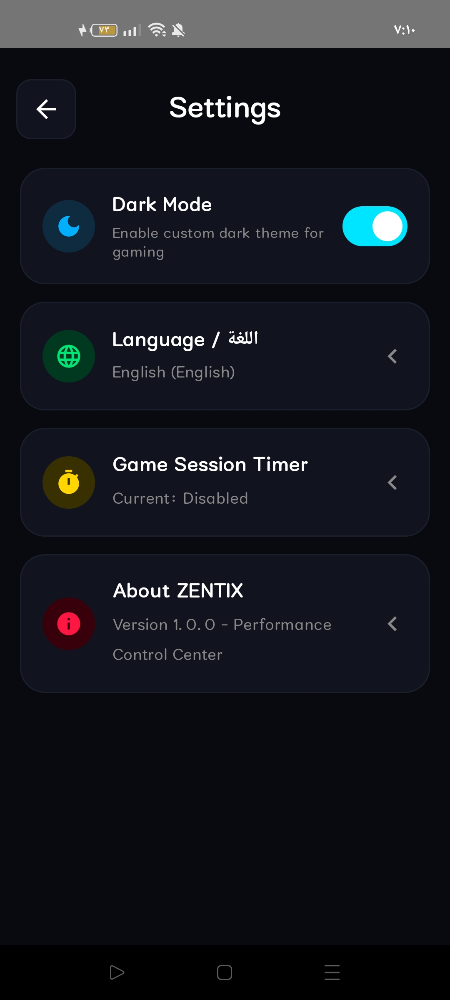
  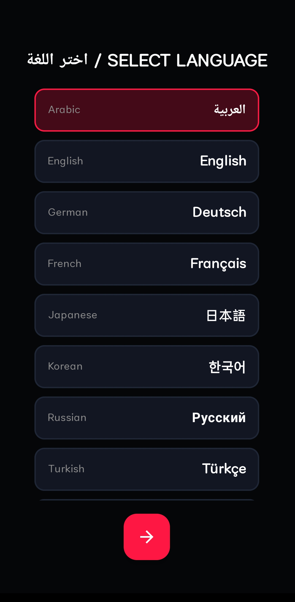
  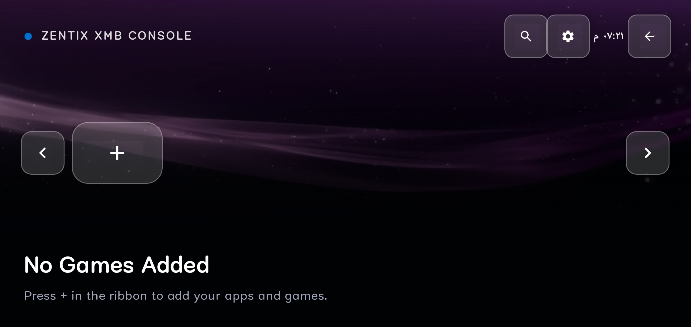

  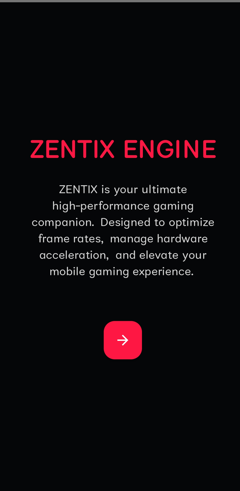
  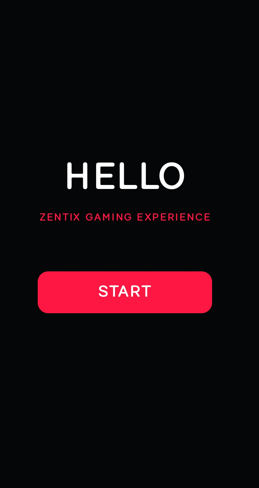
  

### 2. Cinematic Splash & Main Dashboard

  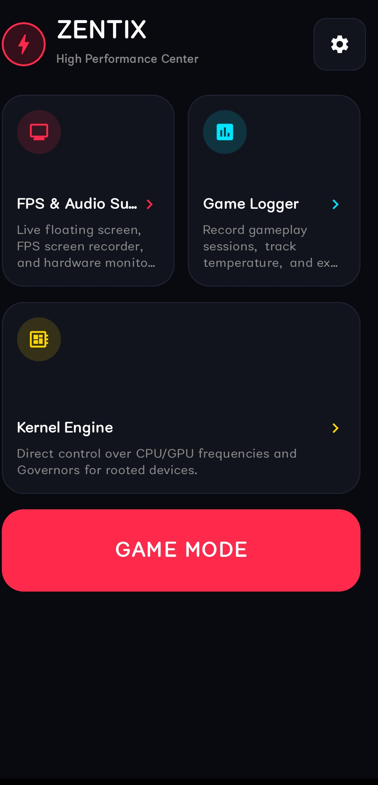
  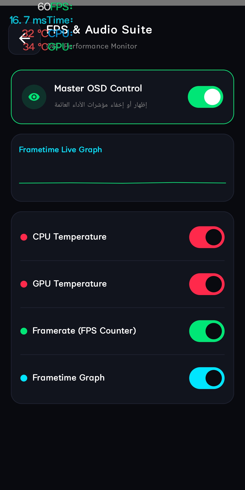
  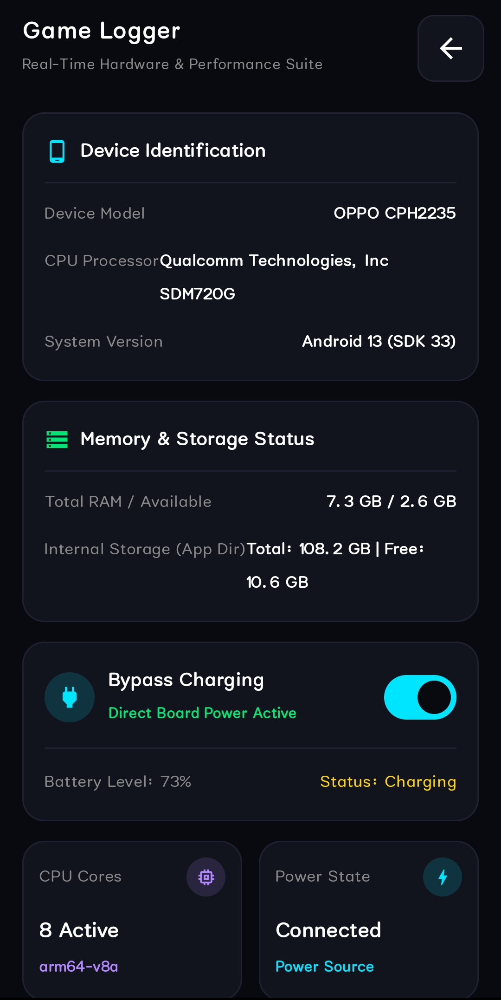

  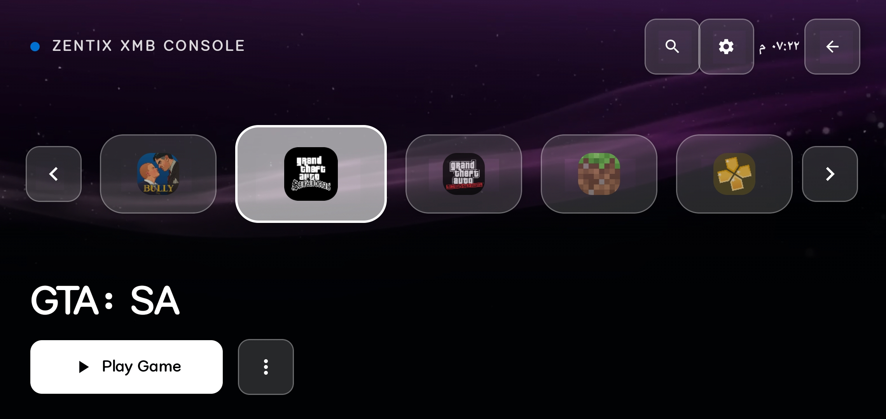

### 3. Hardware Logger & Settings

  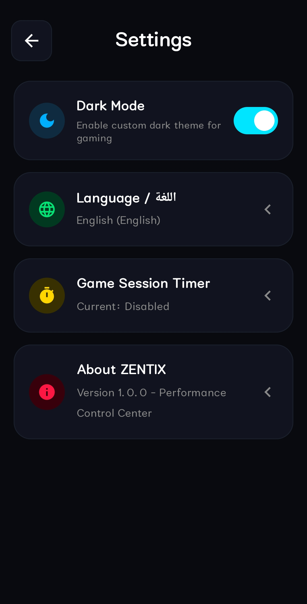
  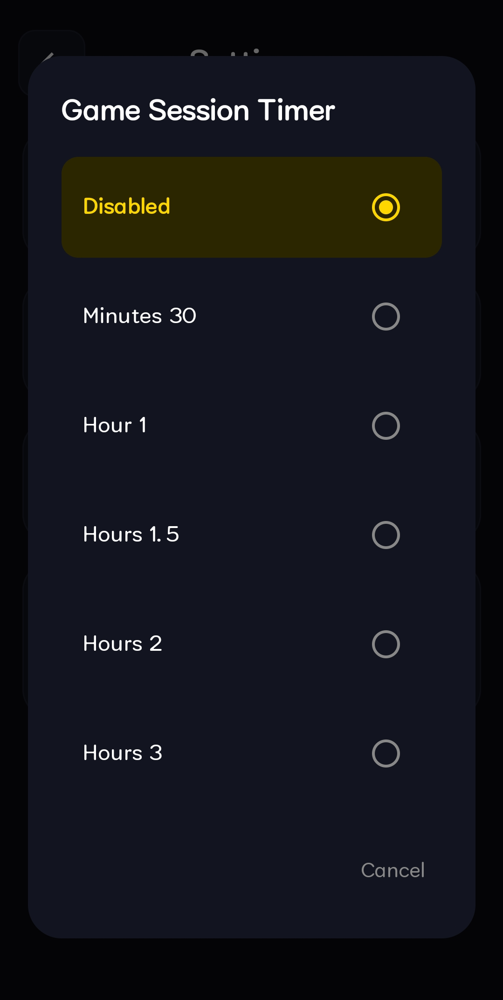
  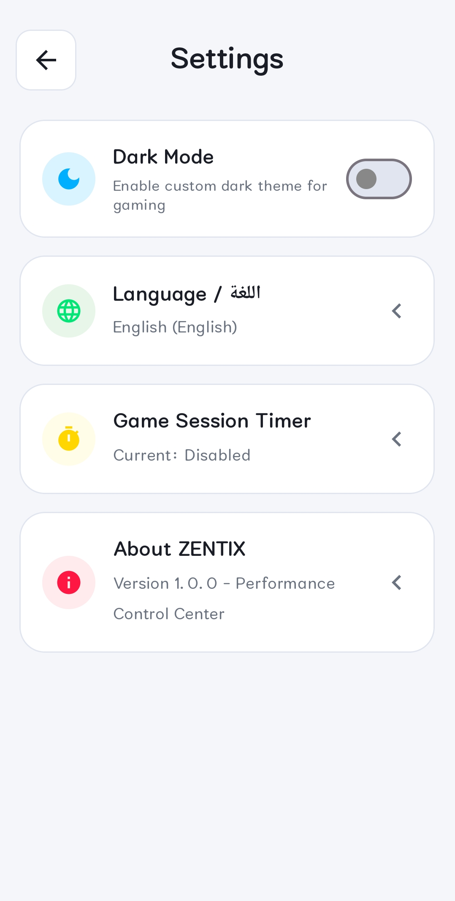

### 4. Customization & XMB Gaming Console

  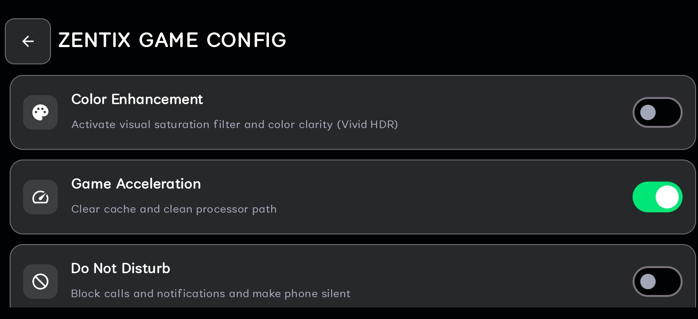
  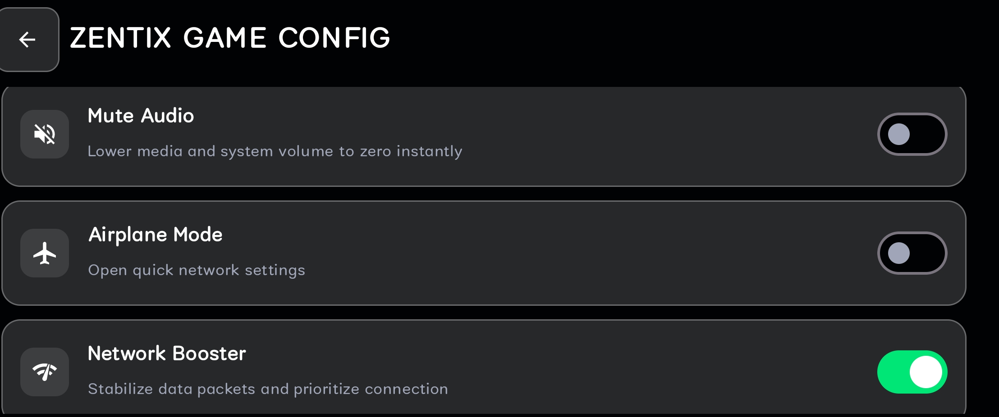
  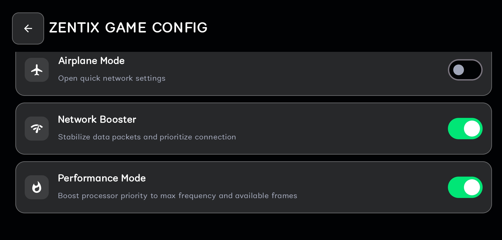

  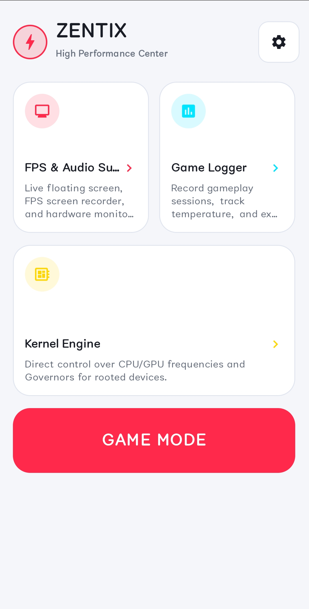
  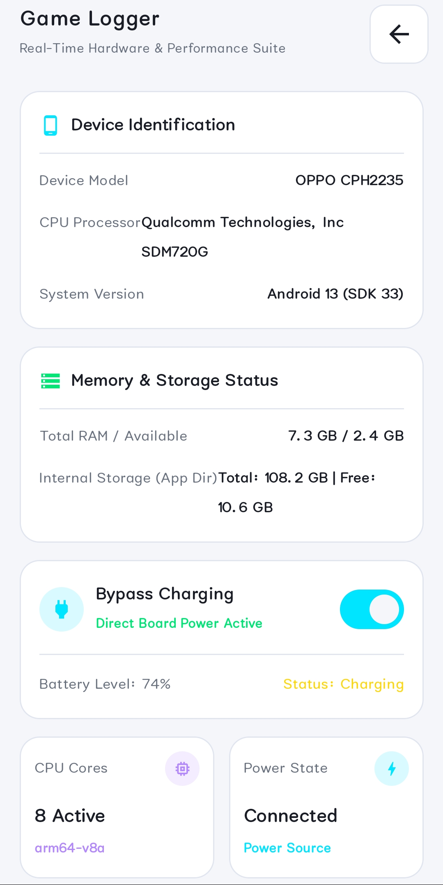
  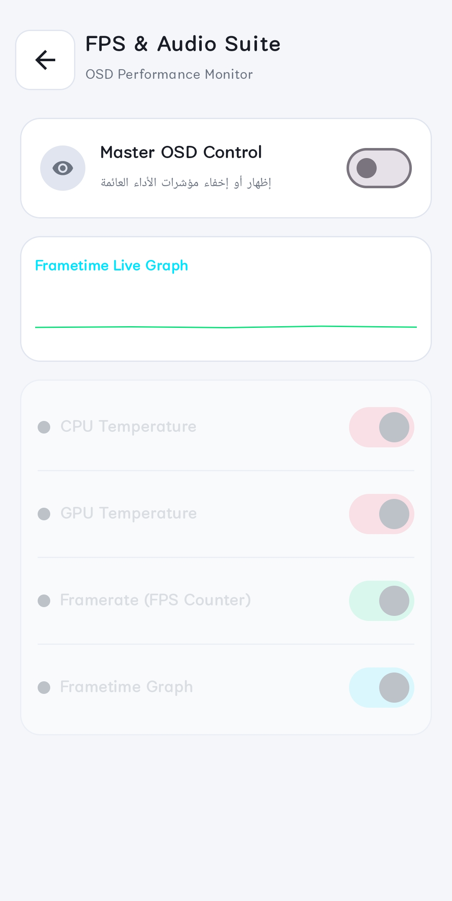

---

## 🎥 Cinematic Intro Preview

Check out the startup video branding experience:
👉 [Watch Intro Video (vid.mp4)](vid.mp4)

---

## 📥 Direct Download
* **[Download Zentix APK v1.0 (Google Drive)](https://drive.google.com/file/d/1faEoAVoqz05ummb2jxgGV2e99yyB0EBg/view?usp=drivesdk)**

---

## 👨‍💻 Developer & Contact
* **Framework:** Jetpack Compose & Kotlin
* **Architecture:** Modern Android UI, SharedPreferences State Management, AndroidView VideoView integration.
* **Developer:** Yahya (يحيى)
* **Phone / WhatsApp:** [:+201553427179](tel:+201553427179)

---

  <b>Built with passion for high-performance mobile gaming. ⚡</b>

